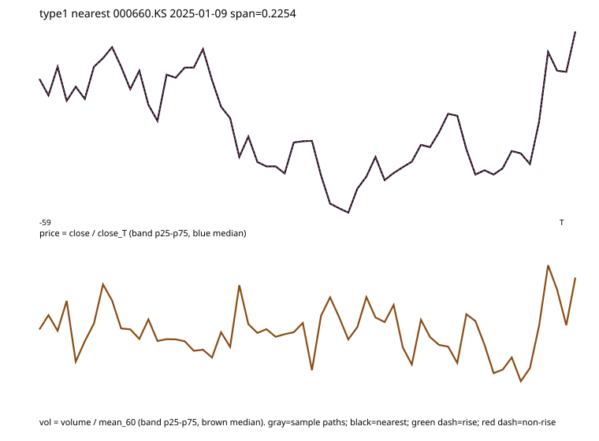
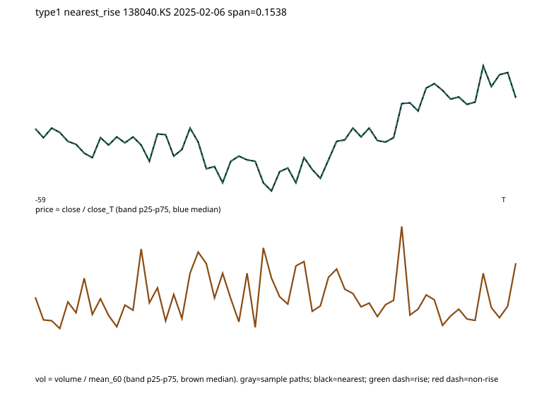
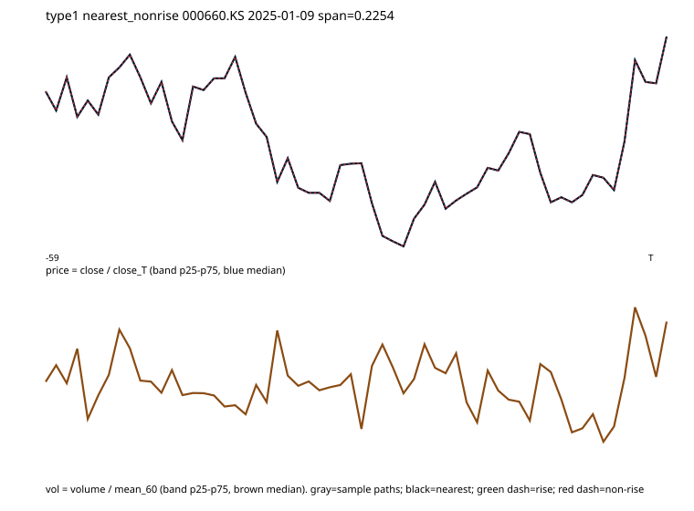

# 상승 전 60봉 흐름 6유형 v4

탐색 연구다. PR #103·#104·#105 결과는 유지한다. 손절 5%·목표 15%·T+20을 바꾸지 않았다. 운영·원본·계좌는 바꾸지 않았다. 두 기간은 이미 썼으므로 독립 검증이 아니다.

이번 유형 1 지속성 확인은 초안 결과를 본 뒤의 후속 탐색이다. 군집·진입·손절·목표는 그대로다.

판단: **관찰 가치**. 기존 판정은 도달률 우위 유형만 수익성을 보므로 유지한다. 도달률 우위 [2, 3, 4, 5], 순손익 우위(평균>0 이고 전체보다 큼) [1], 둘 다 []. 도달률이 높은 유형은 실패 겹침이 남아 있다. 조건·손절을 더하지 않는다.

## 고정 방법 (결과 보기 전)

| 항목 | 값 |
|---|---|
| version | top100_pre_rise_v4_rev1 |
| K | 6 |
| 정규화 | 표본마다 close/close_T, volume/mean_60, 각 L2=1 후 1:1 연결 |
| 거리 | 120차원 유클리드 |
| 군집 | k-means++, seed 1042019, max_iter 50, n_init 1 |
| 최근 기간 | 이전 기간 중심만 배정. 재학습 없음 |
| 가격 기준 | yahoo_chart_quote_ohlcv_daily_adjustment_unverified |
| 스크립트 sha256 | `a148e3aeb068f5c07ab46fadd192727e740e7526b826a3707f624ba7446e89a2` |
| 프로토콜 sha256 | `03fec02f1cd8de444936fa354ddbc0862188c776cd5bd7810bf7e6f9b5a48fc7` |
| 이전 candidates | `f3759695ba120216545474251bf607d2a05d6cd46997b98b5aae9cfc307f3fe9` |
| 최근 candidates | `94060187ee061fad7815e1597e7ef9fd159899a8446232650e1fab6b1d5fc8f5` |

## 이전 기간에서 묶은 6유형

### 유형 0

후반 10봉 상대거래량이 초반보다 작다

대표 최근접: 326030.KS @ 2025-05-07. 상승 최근접: 047810.KS @ 2025-02-07. 비상승 최근접: 326030.KS @ 2025-05-07.

### 유형 1

가격 중앙 경로 진폭이 작다

대표 최근접: 000660.KS @ 2025-01-09. 상승 최근접: 138040.KS @ 2025-02-06. 비상승 최근접: 000660.KS @ 2025-01-09.

### 유형 2

후반 10봉 상대거래량이 초반 20봉보다 크다

대표 최근접: 004020.KS @ 2024-11-12. 상승 최근접: 443060.KS @ 2024-12-20. 비상승 최근접: 004020.KS @ 2024-11-12.

### 유형 3

후반 10봉 상대거래량이 초반 20봉보다 크다

대표 최근접: 128940.KS @ 2025-02-28. 상승 최근접: 214450.KQ @ 2025-06-13. 비상승 최근접: 128940.KS @ 2025-02-28.

### 유형 4

후반 10봉 상대거래량이 초반 20봉보다 크다

대표 최근접: 339950.KQ @ 2025-04-07. 상승 최근접: 339950.KQ @ 2025-04-07. 비상승 최근접: 025860.KS @ 2025-03-28.

### 유형 5

초반 종가가 T의 70% 이하에서 시작해 올라옴 · 후반 10봉 상대거래량이 초반 20봉보다 크다

대표 최근접: 267250.KS @ 2025-07-01. 상승 최근접: 267250.KS @ 2025-07-01. 비상승 최근접: 005385.KS @ 2025-07-14.

## 기간별 유형 성과 (차트 상승 = unconstrained.hit15, 순손익은 보조)

숫자: n / 종목 / 표본점유% / 상승% / 실패% / 전체 대비 도달Δ / 상승 점유% / 중앙 도달봉 / 창 최대하락% 중앙 / 보조 평균순익% / 보조 평균Δ / 가장 바쁜 달 비중%.

| 기간 | 유형 | n | 종목 | 표본% | 상승% | 실패% | 도달Δ | 상승점유% | 도달봉 | 최대하락% | 평균순익% | 순익Δ | 바쁜달% |
|---|---:|---:|---:|---:|---:|---:|---:|---:|---:|---:|---:|---:|---:|
| 2024-10-08~2025-10-02 | 전체 | 3146 | 1119 | 100 | 38.62 | 61.38 | — | — | 5 | -9.9314 | -0.3649 | — | 10.81 |
| 2024-10-08~2025-10-02 | 0 | 277 | 223 | 8.8 | 44.4 | 55.6 | 5.78 | 10.12 | 7 | -9.5207 | 0.8675 | 1.2324 | 15.52 |
| 2024-10-08~2025-10-02 | 1 | 896 | 210 | 28.48 | 29.91 | 70.09 | -8.71 | 22.06 | 10.0 | -6.8804 | 0.522 | 0.8869 | 10.83 |
| 2024-10-08~2025-10-02 | 2 | 310 | 253 | 9.85 | 41.61 | 58.39 | 2.99 | 10.62 | 5 | -10.623 | -0.0905 | 0.2744 | 14.52 |
| 2024-10-08~2025-10-02 | 3 | 498 | 407 | 15.83 | 41.16 | 58.84 | 2.54 | 16.87 | 4 | -11.0296 | -0.8917 | -0.5268 | 12.65 |
| 2024-10-08~2025-10-02 | 4 | 829 | 698 | 26.35 | 41.5 | 58.5 | 2.88 | 28.31 | 3.0 | -12.5172 | -1.1427 | -0.7778 | 14.48 |
| 2024-10-08~2025-10-02 | 5 | 336 | 259 | 10.68 | 43.45 | 56.55 | 4.83 | 12.02 | 5.0 | -11.8499 | -1.2997 | -0.9348 | 15.18 |
| 2025-10-10~2026-10-08 | 전체 | 2643 | 846 | 100 | 50.28 | 49.72 | — | — | 5 | -10.9149 | 0.0034 | — | 11.24 |
| 2025-10-10~2026-10-08 | 0 | 231 | 172 | 8.74 | 49.35 | 50.65 | -0.93 | 8.58 | 5.0 | -12.6572 | -0.7683 | -0.7717 | 17.75 |
| 2025-10-10~2026-10-08 | 1 | 1010 | 232 | 38.21 | 45.94 | 54.06 | -4.34 | 34.91 | 7.0 | -8.845 | 1.0566 | 1.0532 | 11.29 |
| 2025-10-10~2026-10-08 | 2 | 217 | 186 | 8.21 | 50.69 | 49.31 | 0.41 | 8.28 | 5.0 | -12.7907 | -0.5664 | -0.5698 | 16.59 |
| 2025-10-10~2026-10-08 | 3 | 408 | 343 | 15.44 | 54.41 | 45.59 | 4.13 | 16.7 | 4.0 | -13.2926 | -0.7113 | -0.7147 | 13.73 |
| 2025-10-10~2026-10-08 | 4 | 429 | 386 | 16.23 | 53.38 | 46.62 | 3.1 | 17.23 | 2 | -13.8655 | -0.996 | -0.9994 | 14.22 |
| 2025-10-10~2026-10-08 | 5 | 348 | 241 | 13.17 | 54.6 | 45.4 | 4.32 | 14.3 | 5.0 | -11.6914 | -0.1161 | -0.1195 | 15.8 |

최근 기간은 이전 기간 중심에 배정만 했다. 같은 종목의 여러 구간이 있으므로 n으로 독립을 주장하지 않는다. 거래 순손익은 보조다. 유형 2·3·4는 설명 문구가 같아도 중심은 다르며, 이름을 억지로 나누지 않았다.

## 도달률 우위와 순손익 우위 (분리)

기존 판정은 도달률 우위 유형만 수익성 게이트에 넣었다. 아래는 6유형 전체를 따로 본 결과다.

| 구분 | 유형 |
|---|---|
| 도달률 우위 (두 기간 모두 전체보다 높음) | [2, 3, 4, 5] |
| 순손익 우위 (두 기간 모두 평균>0 이고 전체보다 큼) | [1] |
| 둘 다 | [] |

## 유형 1 순손익 지속성 (후속 탐색, 분류 고정)

초안 summary에서 유형 1만 두 기간 비용 반영 평균이 양수이자 전체보다 컸다. 중심·배정·진입·손절 5%·목표 15%는 바꾸지 않았다.

### 2024-10-08~2025-10-02

거래 평균 0.522% (전체 대비 0.8869), 종목 평균 -0.1068% (전체 대비 0.9396). n=896 종목 210.

전반(< 2025-04-08) n=513 평균 -0.9084%. 후반 n=383 평균 2.4381%.

상위 1종목 제외 평균 0.4172% (제외 012450.KS). 상위 5종목 제외 평균 0.152%.

종목 재표집 1000회 거래평균 -0.0925~1.1589, 전체 대비 차이 0.357~1.4024. 종목평균 차이 0.1134~1.7807.

| 청산 | n | 건수점유% | 평균% | 합계 기여% |
|---|---:|---:|---:|---:|
| 목표 | 202 | 22.54 | 14.6555 | 632.9 |
| 손절 | 547 | 61.05 | -5.4348 | -635.56 |
| 기간종료 | 147 | 16.41 | 3.2665 | 102.66 |

| 월 | n | 평균% |
|---|---:|---:|
| 2024-10 | 96 | -2.2496 |
| 2024-11 | 89 | -2.0063 |
| 2024-12 | 81 | 1.8853 |
| 2025-01 | 84 | 0.9012 |
| 2025-02 | 78 | -0.4063 |
| 2025-03 | 76 | -3.6879 |
| 2025-04 | 77 | 4.557 |
| 2025-05 | 77 | 4.5236 |
| 2025-06 | 64 | 2.6564 |
| 2025-07 | 97 | -0.8387 |
| 2025-08 | 77 | 2.0517 |

개별 경로 진폭(max−min of close/close_T) 중앙 0.3052, p25–p75 0.2211–0.4208. 진폭 ≥0.15인 구간 93.08%, ≥0.30인 구간 51.23%. 중앙 경로가 평평해도 개별 차트를 모두 저변동·횡보로 단정하지 않는다.

### 2025-10-10~2026-10-08

거래 평균 1.0566% (전체 대비 1.0532), 종목 평균 0.476% (전체 대비 1.3335). n=1010 종목 232.

전반(< 2026-04-09) n=524 평균 1.8897%. 후반 n=486 평균 0.1584%.

상위 1종목 제외 평균 0.9842% (제외 005935.KS). 상위 5종목 제외 평균 0.777%.

종목 재표집 1000회 거래평균 0.5523~1.5585, 전체 대비 차이 0.6786~1.4583. 종목평균 차이 0.5861~2.0592.

| 청산 | n | 건수점유% | 평균% | 합계 기여% |
|---|---:|---:|---:|---:|
| 목표 | 302 | 29.9 | 14.6555 | 414.73 |
| 손절 | 651 | 64.46 | -5.4467 | -332.26 |
| 기간종료 | 57 | 5.64 | 3.2817 | 17.53 |

| 월 | n | 평균% |
|---|---:|---:|
| 2025-10 | 95 | 5.6497 |
| 2025-11 | 77 | -2.4646 |
| 2025-12 | 91 | -0.7892 |
| 2026-01 | 87 | 5.838 |
| 2026-02 | 75 | 3.2521 |
| 2026-03 | 88 | -0.4365 |
| 2026-04 | 86 | 3.923 |
| 2026-05 | 79 | -1.2036 |
| 2026-06 | 96 | -2.3042 |
| 2026-07 | 110 | -0.0529 |
| 2026-08 | 114 | 0.4148 |
| 2026-09 | 12 | 1.3408 |

개별 경로 진폭(max−min of close/close_T) 중앙 0.3989, p25–p75 0.2738–0.5865. 진폭 ≥0.15인 구간 96.14%, ≥0.30인 구간 69.9%. 중앙 경로가 평평해도 개별 차트를 모두 저변동·횡보로 단정하지 않는다.

### 유형 1 대표·성공·실패 경로

아래는 이전 기간 유형 1의 중심 최근접, 상승 최근접, 비상승 최근접이다. 중앙선이 아니라 개별 60봉이다.

최근접 000660.KS @ 2025-01-09 hit15=False 진폭 0.2254 청산 stop 순익 -5.2846%. 상승 최근접 138040.KS @ 2025-02-06 진폭 0.1538 순익 14.6555%. 비상승 최근접 000660.KS @ 2025-01-09 진폭 0.2254 순익 -5.2846%.

### 최근 기간 배정 차트

## 추천 커버 (손익과 분리)

이전 unknown/not_caught/caught = 0/3055/91. 최근 = 0/2554/89. 부분 커버 미발견은 unknown이다.

## 결론

**관찰 가치.** 기존 판정은 도달률 우위 유형만 수익성을 보므로 유지한다. 도달률 우위 [2, 3, 4, 5], 순손익 우위(평균>0 이고 전체보다 큼) [1], 둘 다 []. 도달률이 높은 유형은 실패 겹침이 남아 있다. 조건·손절을 더하지 않는다.

| 질문 | 내용 |
|---|---|
| 반복 유형 | 중심은 이전 기간에서만 학습하고 최근에 배정. 두 기간 모두 전체보다 도달률이 높은 유형: [2, 3, 4, 5] |
| 상승에서 더 자주? | 표의 상승점유%와 표본 점유(n/전체)를 비교 |
| 실패 겹침 | 실패%가 남아 있으면 같은 모양이 비상승에도 많음 |
| 순손익 우위 | [1] (도달률 게이트 없이 별도) |
| 둘 다 | [] |
| 채택 | 안 함 |
| 구제 | 조건·손절 추가 없음 |
| 후속 | 결과 확인 후 유형 1만 고정 분류로 지속성 검사. 초안은 report-before-rev1.md |
| 재현 | `python docs/research/top100_pre_rise_shapes.py --output <dir> --report docs/top100-pre-rise-v4/report.md` |

결과 JSON은 Git 밖 `history-research/top100-pre-rise-v4/summary.json`, 중심은 `centers.json`.

